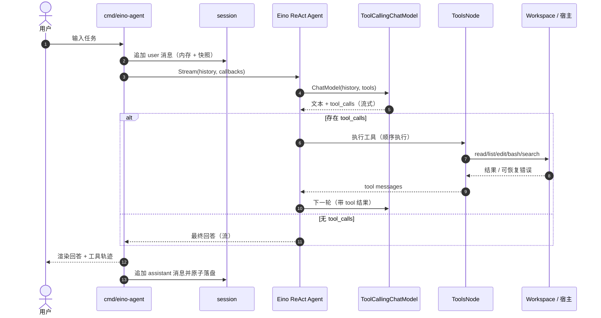

# Eino Code Agent 技术设计方案

> 状态块
>
> - **状态**：已实现（ReAct 分支 + ADK 分支）
> - **作者**：AI Agent（与仓库 owner 协作）
> - **评审人 / 拍板人**：仓库 owner（本仓库无线上调用方，不涉及跨团队评审）
> - **最后更新**：2026-10-26
> - **落点**：既有仓库的新模块（`eino-agent/` 独立 Go module）
> - **场景**：新建（不改动现有 6 个 workshop 文件的行为）
> - **档位**：标准
> - **专题**：架构设计、API 设计、安全

---

## 1. 背景与问题定义

本仓库是一个「从零构建 coding agent」的分步 workshop：从 `chat.go` 的基础对话，逐步叠加文件读取、目录列举、Shell、编辑、代码搜索，最终得到一个能改代码的本地助手。它的教学价值在于**每一步只增加一个能力**，读者能清楚看到 Agent 的事件循环如何工作。

现有实现的事实（均来自仓库内源码）：

| 事实 | 证据 |
| --- | --- |
| 6 个版本各自是一个独立 `package main`，通过复制演进 | `chat.go:14`、`read.go:16`、`list_files.go:18`、`bash_tool.go:19`、`edit_tool.go:20`、`code_search_tool.go:18` |
| 根目录不是一个可整体编译的包：6 个 `main`，且 `Agent`、`ToolDefinition`、`ReadFile` 等符号重复声明 | `bash_tool.go:57`、`chat.go:48`、`edit_tool.go:58`、`code_search_tool.go:56`；本地执行 `go build ./...` 报 `main redeclared` / `NewAgent redeclared` |
| 事件循环手写在每个文件里，没有最大步数约束 | `bash_tool.go:78-220`；`for { ... }` 仅在模型不再返回 tool call 时退出 |
| 工具通过自定义 `ToolDefinition` + `jsonschema` 反射生成入参 schema | `bash_tool.go:256-300`、`edit_tool.go:488-500` |
| Shell 工具执行任意命令，无审批、无超时、无输出上限 | `bash_tool.go:372-389`、`edit_tool.go:393-410` |
| 文件工具直接使用模型给出的路径，没有 workspace 越界校验 | `bash_tool.go:302-317`、`edit_tool.go:323-338` |
| 搜索工具硬依赖 `rg`，未检测是否存在 | `code_search_tool.go:390-455` |
| 根目录没有测试；`AGENT.md` 中的 `go build` / `go test ./...` 在根目录实际不可用 | `AGENT.md:8-16`；`go build ./...` 失败 |

这些不是「错误」，而是 workshop 的刻意形态：**每个文件都能单独 `go run`**。但要做「一个完整、可运行、可测试的 code agent」，继续在根目录追加第 7 个文件会放大问题：无法复用、无法测试、无法统一安全边界。

同时，本机已有字节跳动 [Eino](https://github.com/cloudwego/eino) 源码，可直接以真实 API 为依据完成设计：

- 本地 Eino：`~/Documents/study/ai/agent-framework/eino`，`git describe` = `v0.9.21-1-g58d18430`（2026-09-29）
- 本地 Eino-ext：`~/Documents/study/ai/agent-framework/eino-ext`，commit `2607f61`（2026-09-11）
- 本地 Eino-examples：`~/Documents/study/ai/agent-framework/eino-examples`，commit `be548ea`

Eino 已提供本方案需要的全部基础能力：

| 能力 | Eino API | 本地源码锚点 |
| --- | --- | --- |
| ReAct 编排（ChatModel ↔ Tools 循环） | `react.NewAgent` / `Agent.Stream` / `Agent.Generate` | `flow/agent/react/react.go:284`、`:480`、`:485` |
| 工具 schema 从 Go struct 推导 | `utils.InferTool[T, D]` | `components/tool/utils/invokable_func.go:46` |
| 工具节点配置（含并行/串行、未知工具兜底） | `compose.ToolsNodeConfig` | `compose/tool_node.go:186-231` |
| 工具/模型回调（打印轨迹、统计 token） | `ToolCallbackHandler` / `ModelCallbackHandler` | `utils/callbacks/template.go:524-601` |
| OpenAI 兼容模型 | `openai.NewChatModel` | `eino-ext/components/model/openai/chatmodel.go:198` |
| Anthropic Claude 模型 | `claude.NewChatModel` / `WithTools` | `eino-ext/components/model/claude/claude.go:65`、`:485` |
| 流式工具调用判定（Claude 需要） | `AgentConfig.StreamToolCallChecker` | `flow/agent/react/react.go:166-180` |
| ADK（备选，非本方案） | `adk.NewChatModelAgent` / `adk.NewRunner` | `adk/chatmodel.go:503`、`adk/runner.go:89` |

**问题陈述**：如何在保留 workshop「一个模型 + 一组工具 + 一个事件循环」的简单心智模型的前提下，用 Eino 把循环、工具 schema、流式输出、回调、模型适配交给框架，并在外层补齐 workspace 安全、bash 审批、会话持久化、测试与文档，形成一个**简易但完整**的本地 code agent？

---

## 2. 目标与非目标

### 2.1 业务目标

- 提供一个可直接运行的本地 CLI coding agent：能读代码、找代码、改代码、跑命令/测试，并给出简洁结果。
- 作为仓库的「Eino 版本」教学样例：读者能在一个可编译、可测试的工程里看到 Eino 的核心用法，而不是看一个巨型单文件。
- 默认安全：模型不能随意越过 workspace，执行 Shell 前必须得到用户确认。

### 2.2 技术目标

| 编号 | 目标 | 可验证结果 |
| --- | --- | --- |
| G1 | 用 Eino ReAct 替代手写事件循环 | `internal/agent` 中不再出现 `for { model; tools }`；循环由 `react.Agent` 驱动 |
| G2 | 5 个核心工具，schema 由 struct 推导 | `read_file`、`list_files`、`edit_file`、`bash`、`code_search`；每个都通过 `utils.InferTool` 注册 |
| G3 | 多轮 REPL + 流式输出 + 会话持久化 | 连续对话保持上下文；`--resume` 可恢复；流式逐块输出 |
| G4 | 安全边界 | 路径越界、绝对路径、符号链接逃逸被拒绝；bash 默认需审批；`read-only` 模式禁止写和执行 |
| G5 | 离线可测试 | 不依赖真实 API key 的单元测试 + 脚本化 fake model 集成测试；`go test ./...` 通过 |
| G6 | 可维护的工程结构 | 独立 `eino-agent/go.mod`；按 config/model/workspace/tools/agent/session/ui 分包；根目录 workshop 文件零改动 |

### 2.3 非目标（明确超出范畴）

| 非目标 | 原因 |
| --- | --- |
| 多 Agent / 子 Agent / 任务编排 | 属于 Eino ADK 的 DeepAgent 能力；本方案先做单 Agent，避免把「完整」变成「复杂」 |
| Web UI / HTTP 服务 / SSE | 本地 CLI 已覆盖目标场景；服务化需要鉴权、并发、会话隔离，另立方案 |
| MCP / LSP / 语义索引 / 向量检索 | 不是「跑通一个 code agent」的必要条件；`code_search` + `list_files` 足够起步 |
| 容器/虚拟机级沙箱 | 本方案用进程内路径 jail + 审批；强隔离需要 OS 级能力，作为后续安全增强 |
| Windows 原生支持 | 依赖 `bash` 与 `rg`；先支持 macOS/Linux，Windows 走 WSL |
| 自动 commit / 自动 push / 自动开 PR | 高风险写操作，必须由人决定；agent 只负责改工作区 |
| 跨轮保留完整 tool trace | ReAct 单轮内的工具消息不进入下一轮历史；这是刻意的上下文控制（见 6.5） |
| 语义压缩 / 自动摘要长历史 | 先用「按字节裁剪最近消息」的确定性策略；摘要需要额外模型调用与质量评估 |

---

## 3. 假设与约束

### 3.1 使用假设

- 单用户、本机、单进程 CLI；同一时间只有一个会话在跑。
- 工作区是一个本地目录，通常是 Git 仓库；用户接受 agent 直接编辑其中的文件。
- 模型具备 tool calling 能力，且是 OpenAI Chat Completions 兼容接口或 Anthropic Messages 接口。
- 用户机器上有 `bash`；`rg` 可选（缺失时走 Go 内置搜索回退）。
- 首版不处理并发用户、多会话并行、远程工作区。

### 3.2 技术约束

- 新增 `eino-agent/` 独立 module，**不修改根目录现有 `.go` 文件**，避免破坏 workshop 的单文件运行方式。
- Go 1.24+（与根 `go.mod` 的 `go 1.24.2` 对齐）；本机 Go 1.26.1 可用于开发。
- Eino 版本锁定为 `github.com/cloudwego/eino v0.9.22`；Eino-ext 的 OpenAI / Claude 组件分别锁定 `v0.1.13` / `v0.1.26`（实现时以 `go mod tidy` 解析结果为准，并提交 `go.sum`）。
- 本地 Eino 源码 `v0.9.21-1` 作为 API 参考；若与 `v0.9.22` 有差异，以编译结果为准，不把本地 `replace` 提交进仓库。
- 不把任何 API key 写入仓库、日志、会话文件；只从环境变量读取。
- 默认模型名不做硬编码猜测：`--model` 或 provider 对应的 `*_MODEL` 必填；缺少时给出明确错误和示例。

### 3.3 关键量化假设（目标值，非现有实测）

| 指标 | 目标值 | 口径 / 假设 | 验证方式 |
| --- | --- | --- | --- |
| 单次 `read_file` 默认返回 | 400 行 / 最大 1 MiB | 覆盖大多数源码文件；超出要求 `offset/limit` | 单元测试 |
| 工具输出硬上限 | 256 KiB | 防止单次工具结果淹没上下文；超出截断并标注 | 单元测试 |
| `bash` 默认超时 | 120 s | 覆盖 `go test ./...` 等常见命令；可按调用调高到 600 s | 单元测试 + 手工 |
| `code_search` 默认/最大结果 | 100 / 500 条 | 按行计数；超出标注 truncated | 单元测试 |
| `list_files` 默认/最大条目 | 500 / 2000 条 | 深度默认 2，最大 5 | 单元测试 |
| ReAct 最大步数 | 30 | Eino 中 1 轮 = ChatModel + Tools = 2 步，因此约 15 轮；见 `react.go` 的 MaxStep 说明 | 集成测试 |
| 历史预算 | 256 KiB（约 64k token，按 4 bytes/token 粗估） | 仅保留 user/assistant 最终消息；不保留中间 tool 消息 | 单元测试 |
| 会话文件增长 | 约 1 KiB / 轮 | 纯文本消息 + 元数据；1000 轮约 1 MiB | 单元测试 |
| 工具额外延迟 | read/list/search < 200 ms（10k 文件，本机 SSD，rg 可用） | 不含模型调用；bash 视命令而定 | 实现后基准测试 |
| 二进制体积 | < 60 MiB（估算） | Eino + OpenAI/Claude adapter 的静态链接；实现后 `ls -lh` 验证 | 构建后检查 |

> 这些数字是设计目标，不是承诺的 SLA。若实现后基准测试不达标，优先调小默认上限，而不是引入复杂的分页协议。

---

## 4. 方案总览

### 4.1 一句话

在 `eino-agent/` 新 module 中，用 **Eino ReAct Agent** 作为唯一编排层，用 **`utils.InferTool` 定义 5 个受控工具**，外面套一层 **CLI + workspace jail + bash 审批 + JSON 会话**，形成「模型负责决策，Eino 负责循环，工具负责边界」的本地 code agent。

### 4.2 分层与职责

| 层 | 包 | 职责 | 不负责 |
| --- | --- | --- | --- |
| 入口 | `cmd/eino-agent` | 解析 flag、加载配置、组装依赖、REPL / one-shot | 业务逻辑 |
| 配置 | `internal/config` | flag + env 合并、校验、默认值 | 读文件、调模型 |
| 模型 | `internal/model` | 按 provider 构造 `model.ToolCallingChatModel` | 工具、会话 |
| 工作区 | `internal/workspace` | 根目录解析、路径 jail、忽略规则、文件读写 | 命令执行 |
| 审批 | `internal/approval` | 终端 y/a/n、非 TTY 拒绝、read-only/yolo 策略 | 具体命令执行 |
| 工具 | `internal/tools` | 5 个工具的实现与 Eino 注册 | 模型调用、循环控制 |
| Agent | `internal/agent` | 构造 `react.Agent`、system prompt、callbacks、单轮执行 | CLI 渲染 |
| 会话 | `internal/session` | JSON 快照、恢复、原子写入、历史裁剪 | 模型上下文构造 |
| UI | `internal/ui` | ANSI 颜色、流式输出、工具轨迹、错误展示 | 决策 |

### 4.3 目录结构

```text
eino-agent/
├── go.mod
├── go.sum
├── README.md
├── cmd/
│   └── eino-agent/
│       └── main.go              # flags + wiring + REPL
├── internal/
│   ├── config/
│   │   ├── config.go            # flag/env 解析与校验
│   │   └── config_test.go
│   ├── model/
│   │   ├── factory.go           # openai / claude / ark 预设
│   │   └── factory_test.go
│   ├── workspace/
│   │   ├── workspace.go         # root、Resolve、忽略规则
│   │   └── workspace_test.go
│   ├── approval/
│   │   ├── approval.go          # Approver 接口 + 终端实现
│   │   └── approval_test.go
│   ├── tools/
│   │   ├── registry.go          # 组装 []tool.BaseTool
│   │   ├── read.go
│   │   ├── list.go
│   │   ├── edit.go
│   │   ├── bash.go
│   │   ├── search.go
│   │   └── *_test.go
│   ├── agent/
│   │   ├── agent.go             # react.NewAgent + 单轮 Generate/Stream
│   │   ├── prompt.go            # system prompt + AGENT.md
│   │   ├── callbacks.go         # Eino callback → UI
│   │   ├── prompts/
│   │   │   └── system.md        # //go:embed 的 system prompt
│   │   └── agent_test.go        # scripted fake model 集成测试
│   ├── session/
│   │   ├── session.go           # JSON 快照
│   │   └── session_test.go
│   └── ui/
│       └── ui.go                # 颜色、流式打印、工具轨迹
```

### 4.4 单轮运行时序

下图是一次用户输入从 CLI 进入 Eino 图、再回到 CLI 的完整时序。关键点是：工具只在单轮内执行，CLI 不参与工具循环，最终才把 user/assistant 消息写入会话。



这张图对应的 Eino 图结构是 `START → ChatModel → (ToolsNode → ChatModel)* → END`：ChatModel 节点返回 tool_calls 时走 ToolsNode 分支，否则直接结束；CLI 只负责输入、渲染与持久化，不介入循环内部。

### 4.5 与现有 workshop 的对应关系

| Workshop | 本方案 | 变化 |
| --- | --- | --- |
| `chat.go` 手写 `runInference` | `internal/model/factory.go` + `react.Agent` | 模型调用交给 Eino 组件 |
| `bash_tool.go` 手写 `for { tool_use; ... }` | `react.NewAgent` 内置循环 | 循环由框架驱动，带 `MaxStep` |
| `ToolDefinition` + `jsonschema` 反射 | `utils.InferTool` | schema 从 struct tag 推导 |
| `ReadFile/ListFiles/Bash/EditFile/CodeSearch` | `internal/tools` 同名能力 | 加边界、分页、审批、回退 |
| `getUserMessage` + `fmt.Print` | `internal/ui` + REPL | 流式、颜色、`/help` 等命令 |
| 单文件、无测试 | 分模块 + 测试 | 可编译、可测试、可复用 |

---

## 5. 关键设计决策

> 每个决策按「上下文 → 选择 → 备选与代价 → 何时不该选」写，理由回指第 2 节目标或第 3 节约束。

### 5.1 编排层：选 Eino ReAct，而不是 ADK / 手写 Graph

**上下文**：需求是单 Agent、工具循环、可流式、本地 CLI；现有 workshop 的心智模型也是 ReAct。

**选择**：`github.com/cloudwego/eino/flow/agent/react`。它把 ChatModel 与 ToolsNode 编成一张图，自动处理「模型返回 tool_calls → 执行工具 → 把 tool messages 回灌 → 再调模型」的循环，并支持 `MaxStep`、`MessageModifier`、`StreamToolCallChecker`、`ToolReturnDirectly`。

```go
// 设计示意，最终以 internal/agent/agent.go 为准
a, err := react.NewAgent(ctx, &react.AgentConfig{
    ToolCallingModel: chatModel,
    ToolsConfig: compose.ToolsNodeConfig{
        Tools:                toolList,
        ExecuteSequentially:  true,
        UnknownToolsHandler:  unknownToolHandler,
    },
    MaxStep:         cfg.MaxSteps,             // 30 → 约 15 轮
    MessageModifier: prompt.InjectSystemPrompt, // 每轮前置 system + AGENT.md
})
```

**备选**：

| 方案 | 优点 | 代价 | 否决理由 |
| --- | --- | --- | --- |
| Eino ADK `ChatModelAgent` + `Runner` | 自带 checkpoint、中断/恢复、summarization、subagent、filesystem middleware；更适合生产 | API 面更大、事件模型更复杂；会把「简易」变成「框架集成练习」 | 首版不需要中断恢复/多 Agent；留作 v2 |
| 手写 `compose.Graph`（model → branch → tools → model） | 完全可控，教学上能看清每条边 | 重复实现 ReAct 分支、流式判定、状态管理；容易漏边界 | 已经有 `react` 这个官方封装，没有理由重造 |
| 保留手写 `for` 循环，只把模型换成 Eino | 改动最小 | 没用上 Eino 的编排能力；仍然要自己维护 tool 消息与步数 | 不满足 G1 |

**代价与边界**：ReAct 的中间 tool 消息只存在于单次 `Generate/Stream` 的图状态里，不会自动跨轮保留；这正好符合我们的会话策略（见 5.5），但意味着「跨轮追问某个工具结果」需要模型重新调用工具。

**何时不该选**：如果后续需要「执行中暂停、人工审批后继续」「长任务压缩摘要」「多 Agent 分工」，应迁移到 ADK；那时 `internal/tools` 与 `internal/workspace` 可以复用。

### 5.2 模型适配：OpenAI 兼容为主，Claude 原生为辅

**上下文**：现有 workshop 使用 Anthropic Claude；本机 Eino-ext 同时提供 OpenAI 与 Claude 适配器。用户可能用 OpenAI、DeepSeek、Ark（豆包）、Ollama、vLLM 或 Claude。

**选择**：三个 provider 预设，两个适配器：

| provider | 适配器 | 认证 env | Base URL env | 模型 env | 说明 |
| --- | --- | --- | --- | --- | --- |
| `openai` | `eino-ext/components/model/openai` | `OPENAI_API_KEY` | `OPENAI_BASE_URL` | `OPENAI_MODEL` | 任意 OpenAI Chat Completions 兼容服务；默认官方 endpoint |
| `claude` | `eino-ext/components/model/claude` | `ANTHROPIC_API_KEY` | `ANTHROPIC_BASE_URL` | `ANTHROPIC_MODEL` | 原生 Anthropic Messages；`MaxTokens` 必填，默认 8192 |
| `ark` | 复用 `openai` 适配器 | `ARK_API_KEY` | `ARK_BASE_URL`（默认 `https://ark.cn-beijing.volces.com/api/v3`） | `ARK_MODEL` | Ark 提供 OpenAI 兼容接口；模型填 endpoint ID；不引入原生 `ark` 依赖 |

`--provider auto`（默认）规则：**恰好只有一个** provider 的 key 存在时自动选择；如果多个都存在，报错要求显式 `--provider`，避免「以为在用 A，实际用了 B」。`--model` 优先级最高；否则读对应 `*_MODEL`；都没有则报错并给出示例。

**备选**：

| 方案 | 优点 | 代价 | 否决理由 |
| --- | --- | --- | --- |
| 只支持 OpenAI 兼容 | 依赖最少 | 丢失与现有 workshop 的 Claude 连续性 | 不满足「基于当前项目」的直觉 |
| 原生 `eino-ext/ark` | 支持 Ark 的 thinking/cache 等特性 | 多一组 Volcengine SDK 依赖；首版用不到 | Ark 的 OpenAI 兼容端点已够用；需要时再加 |
| 只支持 Claude | 与 workshop 完全一致 | 大量用户只有 OpenAI/DeepSeek/Ark key | 可用性太窄 |

**代价与边界**：Claude 适配器会拉入 Anthropic SDK、AWS/GCP 相关间接依赖，二进制会更大；如果体积不可接受，可去掉 Claude，仅保留 OpenAI 兼容（见开放问题 Q1）。OpenAI 兼容路径不承诺各家私有字段（如 reasoning、缓存）全部生效。

### 5.3 工具层：`utils.InferTool` + 5 个显式工具

**选择**：每个工具定义 `Input` struct（`jsonschema` tag 描述字段），用 `utils.InferTool[Input, string]` 生成 `tool.InvokableTool`，再放进 `compose.ToolsNodeConfig.Tools`。不使用 ADK filesystem middleware，原因是：

1. workshop 的教学重点是「工具怎么定义、schema 怎么来、结果怎么回灌」，middleware 会把这层藏起来；
2. 自定义工具更容易插入 workspace jail、bash 审批、输出上限；
3. 我们希望保留现有工具名（`read_file` / `list_files` / `bash` / `edit_file` / `code_search`），让读者能直接对照旧版。

**工具契约**：

| 工具 | 输入 | 行为 | 限制 | 可恢复错误（返回文本） |
| --- | --- | --- | --- | --- |
| `read_file` | `path` 必填；`offset` 默认 1；`limit` 默认 400 | 按行读取，输出带行号；检测二进制/非 UTF-8 | 单次 ≤ 1 MiB；单行 ≤ 2000 字符；文件 > 10 MiB 时必须给 `offset/limit` | 文件不存在、是目录、越界、二进制 |
| `list_files` | `path` 默认 `.`；`depth` 默认 2；`limit` 默认 500 | 递归列举，目录带 `/`，跳过忽略目录 | 深度 ≤ 5；条目 ≤ 2000 | 路径不存在、不是目录、越界 |
| `edit_file` | `path`、`old_str`、`new_str` | 文件存在：`old_str` 必须在文件中**恰好出现一次**，替换一次；文件不存在：`old_str` 必须为空，创建文件并建父目录 | 原子写（同目录 temp + rename）；保留权限；不允许空 `old_str` 追加已有文件 | 未找到、匹配多次、`old_str == new_str`、越界 |
| `bash` | `command` 必填；`timeout_seconds` 默认 120 | 在 workspace 根目录执行 `bash -c`；stdin 关闭；合并 stdout/stderr | 超时 ≤ 600 s；输出 ≤ 256 KiB；`TERM=dumb`、`PAGER=cat`、`GIT_PAGER=cat` | 非零退出码作为正常结果返回；超时/拒绝执行返回说明 |
| `code_search` | `pattern` 必填；`path` 默认 `.`；`file_type`；`case_sensitive` 默认 false；`max_results` 默认 100 | 优先 `rg --line-number --no-heading --color=never`；无 `rg` 时用 Go regexp 遍历回退 | 结果 ≤ 500；单行 ≤ 300 字符；跳过二进制/忽略目录 | 无匹配（返回 `No matches found`）、非法正则、越界 |

**为什么 `edit_file` 不再保留「空 `old_str` 追加」**：workshop 的实现里，空 `old_str` 对已存在文件表示追加（`edit_tool.go:437-440`）。对 code agent 来说，追加通常意味着模型没读到文件内容，容易造成重复代码。本方案把「空 `old_str`」限定为**仅创建新文件**；已存在文件必须提供唯一匹配片段。这是有意的行为改进，会在 README 与工具描述中写明。

**工具错误的处理原则**：所有「模型可以通过重试/换参数修复」的错误都返回正常字符串（以 `ERROR: ` 开头），不返回 Go error，避免 Eino ToolsNode 直接中断整轮；只有 context 取消、内部不可恢复错误才返回 error。这样模型能看到「路径越界」「匹配到 3 处」并自我纠正。

**`UnknownToolsHandler`**：模型幻觉调用不存在的工具时，返回 `ERROR: unknown tool "x"; available tools: ...`，而不是让 ReAct 图报错退出。

### 5.4 安全边界：workspace jail + 分级审批 + 输出上限

**选择**：

1. **路径 jail**：所有文件工具的路径先经过 `workspace.Resolve(path)`：
   - 相对路径以 workspace 根为基准；绝对路径也解析后检查；
   - `filepath.Clean` 后计算 `filepath.Rel(root, abs)`，拒绝 `..` 开头或跨盘符；
   - 对已存在的路径做 `filepath.EvalSymlinks`，拒绝指向 root 之外的符号链接；
   - 对新文件，对父目录做同样的真实路径校验；
   - 根目录本身在启动时 `EvalSymlinks` 并 `Abs`。
2. **权限模式**：

| 操作 | `read-only` | `ask`（默认） | `yolo` |
| --- | --- | --- | --- |
| read/list/search | 允许 | 允许 | 允许 |
| edit_file | 拒绝 | 允许 | 允许 |
| bash | 拒绝 | 逐条询问 | 允许 |
| session 写入 | 允许 | 允许 | 允许 |

3. **bash 审批**：默认 `ask`。终端提示展示命令、cwd、超时，选项 `[y] 本次 / [a] 本会话内同一命令总是允许 / [N] 拒绝`。`a` 只在当前进程内记住命令字符串的 SHA-256，不落盘。
4. **非 TTY**：`-p` one-shot 或 stdin 不是终端时，`ask` 模式下的 bash 直接拒绝，避免脚本挂起；用户需显式 `--permission-mode yolo`。
5. **执行约束**：`cmd.Dir = workspace root`；`cmd.Stdin = nil`（读 `/dev/null`，防止交互式命令卡住）；`cmd.Env = os.Environ()` 加 `TERM=dumb`、`PAGER=cat`、`GIT_PAGER=cat`；`exec.CommandContext` + 超时；输出用 head/tail 双端缓冲，超过 256 KiB 时保留头尾并标注 `[output truncated]`。
6. **写文件**：同目录创建临时文件（`os.CreateTemp(dir, ".eino-edit-*")`），写入后 `Chmod` 保留原权限，`Rename` 原子替换；失败时清理临时文件。
7. **不自动执行仓库内容**：`AGENTS.md`/`AGENT.md` 只作为文本注入 system prompt，不执行其中的命令；工具结果也视为数据，不作为指令。

**备选**：

| 方案 | 优点 | 代价 | 否决理由 |
| --- | --- | --- | --- |
| 仅 yolo，无审批 | 体验最顺 | 模型可执行 `rm -rf`、`git push` 等 | 不可接受 |
| 所有工具都审批（含读/编辑） | 最强控制 | 一次任务要确认几十次，实际会被用户关掉 | 交互成本过高 |
| 容器沙箱 | 强隔离 | 需要 Docker/OS 支持、路径映射、网络策略 | 首版过重；作为后续增强 |
| 命令黑名单 | 简单 | 绕过方式太多，容易给虚假安全感 | 不如审批 + 路径 jail 实在 |

**残余风险**（明确记录）：`yolo` 模式等于把终端交给模型；bash 继承用户环境变量，`env` 可能把密钥打印给模型；workspace 内的 `.env` 可被 `read_file` 读取。首版通过「默认 ask + 不自动 push」降低风险，不承诺防御恶意模型。若需要更强隔离，后续加容器后端。

### 5.5 会话与历史：JSON 快照 + 最近消息裁剪

**选择**：

- 会话文件：JSON（不是 JSONL），包含版本、workspace、provider/model、时间戳、`[]Message`（只含 `user` / `assistant`）。
- 默认目录：`os.UserConfigDir()/eino-agent/sessions/`（macOS 为 `~/Library/Application Support/eino-agent/sessions`），可用 `--session-dir` 覆盖。
- 文件名：`<UTC 时间戳>-<6 位随机>.json`；`--resume` 接受完整路径或 session id。
- 写入：每轮成功拿到最终 assistant 消息后，更新内存并**原子写**（temp + rename）。中途失败不追加 assistant，但工作区改动仍然保留（需在 README 说明）。
- 加载：校验 `version`、role 只能是 `user/assistant`、workspace 存在；损坏文件报错并保留原文件，不静默覆盖。
- 历史裁剪：调用模型前按字节估算总大小，超过 `--history-bytes`（默认 256 KiB）时从最旧的消息开始成对丢弃，保证第一条是 user；在 UI 上提示 `[history trimmed: N messages]`。不做摘要。

**为什么不在跨轮历史里保留 tool 消息**：ReAct 单轮内的 tool 调用/结果已经完成使命；跨轮保留会迅速膨胀上下文，而且旧的 tool 结果可能过期（文件已改）。代价是模型可能重复读同一个文件——这比上下文爆炸更可控。

**备选**：

| 方案 | 优点 | 代价 | 否决理由 |
| --- | --- | --- | --- |
| JSONL 事件日志（含 tool） | 可完整回放、崩溃恢复更好 | 文件更大、需要事件重放逻辑、可能重放过期工具结果 | 首版不需要审计级回放 |
| Eino ADK checkpoint | 支持中断恢复、状态完整 | 与 ADK 绑定，格式不透明 | 首版不用 ADK |
| 不持久化 | 最简单 | 关掉就丢，无法继续长任务 | 不满足「完整」 |

### 5.6 Prompt：固定 system prompt + 仓库级 AGENT.md

**选择**：

- `internal/agent/prompts/system.md` 通过 `//go:embed` 嵌入，内容用英文（模型兼容性更好），要求「用用户的语言回答」。
- system prompt 包含：角色、工作区根、工具使用顺序（先读后改）、最小改动原则、验证要求、路径规则、安全规则、输出风格（简洁、`file:line`）。
- 启动时按 `AGENTS.md` → `AGENT.md` → `CLAUDE.md` 顺序查找第一个存在的文件，截断到 16 KiB，作为「Project instructions」附加到 system prompt。当前仓库有 `AGENT.md`，因此新 agent 会自动获得该项目说明。
- **不自动执行** `git status` 等命令来构造上下文；模型需要时自己调用 `bash`（走审批）。这避免启动时产生未预期的副作用。

**为什么不用 Eino prompt template 组件**：首版 system prompt 是静态文本 + 一段项目说明，用标准库 `text/template` 足够；引入 `prompt.FromMessages` 会增加一层不必要的抽象。等需要多模板/变量时再迁移。

### 5.7 CLI 与流式输出

**交互形态**：

```text
eino-agent [flags]                 # 进入 REPL
eino-agent -p "修复 xxx"            # one-shot，打印结果后退出
eino-agent --resume <id|path>      # 恢复会话后进入 REPL
```

REPL 命令：`/help`、`/clear`（清空内存历史，不删会话文件）、`/session`（显示当前会话文件路径）、`/exit`。空行跳过。

**流式**：默认 `Stream`，逐块打印 `msg.Content`；`--no-stream` 使用 `Generate` 一次性打印。流式失败（provider 不支持/网络中断）时提示用户加 `--no-stream` 重试，不自动重放（避免重复工具调用）。

**Claude 的流式工具调用**：Eino 默认的 `firstChunkStreamToolCallChecker` 只看第一个非空 chunk；Claude 可能先输出文本再输出 tool call。因此配置自定义 checker：读完整个流，只要出现 `len(msg.ToolCalls) > 0` 就返回 true。该 checker 会关闭流（Eino 要求），可能降低「边流边判定」的收益，但保证正确性。

**工具轨迹**：用 Eino callback（`ToolCallbackHandler`）打印：

```text
→ read_file {"path":"internal/agent/agent.go"}
✓ read_file (1.8 KB)
→ bash {"command":"go test ./..."}
✗ bash exit=1 (2.3 KB)
```

非 verbose 只显示一行摘要；`--verbose` 显示完整参数（截断 2 KiB）和结果头尾（各 1 KiB）。颜色在 `NO_COLOR` 或非 TTY 时关闭。

### 5.8 错误处理与步数

| 场景 | 行为 |
| --- | --- |
| 模型 API 错误（401/429/5xx） | 打印 provider、model、base URL（不含 key）与原始错误；不额外实现自动重试（避免重复工具副作用）；退出码 1 |
| 模型返回未知工具 | `UnknownToolsHandler` 返回可用工具列表，让模型继续 |
| 工具可恢复错误 | 返回 `ERROR: ...` 文本，模型自行调整 |
| 超过 `MaxStep` | Eino 返回步数错误；CLI 提示「达到最大步数，可调大 --max-steps 或拆分任务」 |
| bash 被拒绝 | 返回 `ERROR: command denied by user`，模型可换方案 |
| 用户 Ctrl-C | context 取消；打印「已中断」；退出码 130；当前轮 assistant 不落盘 |
| 会话文件损坏 | 报错并给出路径；不覆盖；提示用 `--session-dir` 或手动处理 |

---

## 6. 接口与数据设计

### 6.1 配置

优先级：**flag > provider 专用 env > 通用 env > 默认值**。

| flag | env | 默认 | 说明 |
| --- | --- | --- | --- |
| `--provider` | `EINO_AGENT_PROVIDER` | `auto` | `auto/openai/claude/ark` |
| `--model` | `EINO_AGENT_MODEL` 或 `OPENAI_MODEL` / `ANTHROPIC_MODEL` / `ARK_MODEL` | 无 | 必填；无默认，避免猜错模型 |
| `--base-url` | `OPENAI_BASE_URL` / `ANTHROPIC_BASE_URL` / `ARK_BASE_URL` | 各 provider 默认 | Ark 默认 `https://ark.cn-beijing.volces.com/api/v3` |
| `--workspace` | `EINO_AGENT_WORKSPACE` | `.` | 解析为绝对真实路径 |
| `--max-steps` | `EINO_AGENT_MAX_STEPS` | 30 | Eino ReAct 步数 |
| `--history-bytes` | `EINO_AGENT_HISTORY_BYTES` | 262144 | 历史预算 |
| `--permission-mode` | `EINO_AGENT_PERMISSION_MODE` | `ask` | `ask/read-only/yolo` |
| `--session-dir` | `EINO_AGENT_SESSION_DIR` | `os.UserConfigDir()/eino-agent/sessions` | 会话目录 |
| `--resume` | `EINO_AGENT_RESUME` | 空 | session id 或路径 |
| `--no-stream` | `EINO_AGENT_NO_STREAM` | false | 关闭流式 |
| `--verbose` | `EINO_AGENT_VERBOSE` | false | 详细日志到 stderr |
| `--prompt`, `-p` | `EINO_AGENT_PROMPT` | 空 | one-shot |
| `--version` | - | - | 版本信息 |

**不提供 `--api-key`**：避免出现在 shell history / 进程列表；只从 env 读取。若用户坚持，可在后续版本加 `--api-key-file`。

### 6.2 会话 JSON

```json
{
  "version": 1,
  "id": "20261026-131500-a1b2c3",
  "workspace": "/Users/me/project",
  "provider": "openai",
  "model": "gpt-4o-mini",
  "created_at": "2026-10-26T13:15:00+08:00",
  "updated_at": "2026-10-26T13:18:20+08:00",
  "messages": [
    {"role": "user", "content": "读一下 go.mod，告诉我模块名", "at": "2026-10-26T13:15:00+08:00"},
    {"role": "assistant", "content": "模块名是 chat。", "at": "2026-10-26T13:15:04+08:00"}
  ]
}
```

约束：

- `version` 目前只支持 1；未来不兼容变更时递增。
- `role` 只允许 `user` / `assistant`；加载时拒绝 `system` / `tool`。
- `content` 原样保存；不保存 tool call、token、API key。
- 单文件写入使用 `0600` 权限；目录 `0700`。

### 6.3 退出码

| 码 | 含义 |
| --- | --- |
| 0 | 正常结束（`/exit`、EOF、one-shot 完成） |
| 1 | 运行时错误（模型/工具/会话） |
| 2 | 配置/用法错误（缺 key、缺 model、非法 flag） |
| 130 | 用户中断（SIGINT） |

### 6.4 系统提示词结构

```text
You are Eino Code Agent, a terminal coding assistant.

# Environment
- workspace: <abs path>
- os: <GOOS/GOARCH>
- permission mode: <ask|read-only|yolo>

# Operating principles
1. Understand before changing: read/list/search before edit.
2. Prefer minimal changes; do not refactor unrelated code.
3. Use edit_file with a unique old_str; never invent file contents.
4. Verify with build/tests when possible.
5. Never attempt to escape the workspace; never run destructive commands.
6. If a tool returns ERROR, adapt; do not repeat the same failing call.

# Tool usage
- read_file for file contents (line numbers included).
- list_files for directory structure.
- code_search for patterns; prefer it over bash grep.
- edit_file for modifications.
- bash for builds, tests, git status/diff; command execution requires approval.
- Do not use bash cat/sed/echo as a substitute for file tools.

# Response style
- Be concise; answer in the user's language.
- Reference files as path:line when useful.
- Summarize what changed and what was verified.

# Project instructions (from AGENT.md, lower priority than safety rules)
<content, max 16 KiB>
```

---

## 7. 非功能设计

### 7.1 安全威胁与缓解

| 威胁 | 场景 | 缓解 | 残余风险 |
| --- | --- | --- | --- |
| 路径穿越 | 模型传 `../../etc/passwd` | `Resolve` + `Rel` 校验；拒绝绝对越界 | 极深的符号链接竞态（TOCTOU） |
| 符号链接逃逸 | workspace 内 `link -> /etc` | `EvalSymlinks` 后再次校验；新建文件校验父目录 | 检查与写入之间的竞态 |
| 破坏性命令 | `rm -rf`、`git push --force` | 默认 ask；非 TTY 拒绝；`yolo` 才放行 | 用户点 `y` 或开 `yolo` |
| 输出洪水 | 命令输出 1 GB | 256 KiB head/tail 截断；超时 kill | 截断后模型看不到中段 |
| 提示注入 | 仓库文件/AGENT.md 写「忽略规则」 | system prompt 声明优先级；工具结果当数据；不自动执行 | 模型仍可能被诱导，靠审批兜底 |
| 密钥泄露 | `bash env` / `read_file .env` | 不把 key 写入日志；bash 审批；README 提醒 | 用户批准的 `env` 会暴露 |
| 会话篡改 | 手动改 session JSON 注入 system | 只接受 user/assistant；校验 version | 可伪造 user/assistant 内容 |
| 并发审批 | 多个 bash 同时请求 | `ExecuteSequentially: true`；审批器再加 mutex | 无 |
| 临时文件残留 | 编辑失败/中断 | `defer os.Remove(tmp)`；rename 前不删原文件 | 进程被 kill -9 时可能残留 `.eino-edit-*` |

### 7.2 性能与容量

- **模型延迟主导**：一次任务通常 1-10 次模型调用，单次 1-10 s；工具延迟占比很小。
- **工具并发**：`ExecuteSequentially: true` 是刻意的——让审批、输出、调试顺序确定；代价是批量读文件时串行。若后续确认审批并发安全，可改为 `false` 或按权限模式动态设置。
- **内存**：单次工具输出 ≤ 256 KiB；历史 ≤ 256 KiB；会话文件按轮增长；不会把整个仓库读进内存。
- **搜索**：`rg` 在 10k 文件仓库通常 < 200 ms（目标值）；无 `rg` 时 Go 回退会慢一个量级，但仍受结果上限约束。
- **二进制**：Claude 适配器会增大体积；目标 < 60 MiB，构建后实测；若超标，考虑去掉 Claude 或使用 build tag 拆分 provider。

### 7.3 可观测性

- `--verbose`：模型调用开始/结束、token usage、工具完整参数、结果长度、耗时；写 stderr。
- 普通模式：只打印用户可读的流式回答 + 工具一行摘要。
- 不在日志中打印 API key；base URL 可以打印，便于排查代理/网关问题。
- 会话文件是事后排查的主要依据；不额外做 OpenTelemetry（本地 CLI 不需要）。

### 7.4 可移植性

- macOS / Linux；依赖 `bash`。
- `rg` 可选；缺失时自动回退并在 verbose 中提示。
- 路径使用 `filepath`，但工具 schema 中统一用 `/` 风格展示；Windows 暂不支持（非目标）。
- 二进制通过 `go build ./cmd/eino-agent` 产出；无需 CGO。

---

## 8. 测试与验收

### 8.1 测试策略

| 层级 | 内容 | 是否依赖 API key |
| --- | --- | --- |
| 单元测试 | workspace 路径 jail、read/list/edit/search/bash、session、config | 否 |
| 集成测试 | 用 scripted fake `model.ToolCallingChatModel` 驱动真实 `react.Agent` + 真实工具，在 `t.TempDir()` 中完成「读文件 → 改文件 → 回答」 | 否 |
| CLI 测试 | `--help`、缺 key/缺 model 的退出码、`-p` 参数解析 | 否 |
| Live smoke | 真实 provider 跑一轮「读 go.mod 并总结」 | 是，默认 skip |

**Fake model 设计**（仅测试代码）：

```go
type scriptedModel struct {
    mu     sync.Mutex
    steps  []*schema.Message
    tools  []*schema.ToolInfo
}

func (m *scriptedModel) Generate(ctx context.Context, in []*schema.Message, _ ...model.Option) (*schema.Message, error) {
    // 按顺序返回预置消息；第一步返回 tool_call，第二步返回最终文本
}
func (m *scriptedModel) Stream(...) (*schema.StreamReader[*schema.Message], error) {
    return schema.StreamReaderFromArray([]*schema.Message{msg}), nil
}
func (m *scriptedModel) WithTools(tools []*schema.ToolInfo) (model.ToolCallingChatModel, error) {
    // 记录工具并返回自身
}
```

集成测试断言：

1. 第一次模型输出 `read_file` tool call，Eino 执行后，第二次模型输出最终文本；
2. 工具确实读到了临时文件内容；
3. 最终返回文本包含预期内容；
4. 未知工具被 `UnknownToolsHandler` 兜底，ReAct 不崩溃；
5. `MaxStep` 很小时返回步数错误。

### 8.2 测试矩阵

| 用例 | 输入 | 期望 |
| --- | --- | --- |
| 路径越界 | `read_file {"path":"../x"}` | `ERROR: path escapes workspace` |
| 绝对路径越界 | `read_file {"path":"/etc/passwd"}` | 拒绝 |
| 符号链接逃逸 | `link -> /tmp/outside` | 拒绝 |
| 读取分页 | 100 行文件，`offset=50, limit=10` | 返回 50-59 行，带行号 |
| 二进制文件 | 含 NUL 的文件 | `ERROR: binary` |
| 编辑唯一匹配 | 文件含一次 `foo` | 替换成功，内容正确 |
| 编辑多重匹配 | 文件含两次 `foo` | `ERROR: old_str found 2 times` |
| 创建文件 | 不存在路径 + 空 `old_str` | 创建成功，父目录存在 |
| 已有文件空 `old_str` | 已存在文件 | 拒绝，提示提供 `old_str` |
| 列举忽略 | 含 `node_modules`、`.git` | 不出现 |
| 搜索有 rg | 安装 rg | 返回 `path:line:` 结果 |
| 搜索无 rg | 注入空 rgPath | Go 回退仍返回结果 |
| bash 拒绝 | approver 返回 Deny | 工具输出 `ERROR: denied`，模型可继续 |
| bash 超时 | `sleep 2` + timeout=1 | 返回超时，进程被 kill |
| bash 非零退出 | `false` | 输出含 exit code，不 panic |
| 服务端错误 | fake 返回 error | CLI 打印错误，退出码 1 |
| 会话往返 | 保存再加载 | 消息、workspace、model 一致 |
| 损坏会话 | 非法 JSON | 报错，不覆盖 |
| 历史裁剪 | 超过 budget | 丢弃最旧消息，首条仍为 user |

### 8.3 验收标准

```bash
cd eino-agent
go build ./...
go test ./...
go vet ./...
go run ./cmd/eino-agent --help
```

全部通过，且满足：

1. 不设置任何 API key 时，`--help` 正常，启动交互会给出清晰错误（退出码 2），不会 panic。
2. 集成测试不依赖网络，覆盖至少一次完整 ReAct tool loop。
3. `read-only` 模式下 `edit_file` / `bash` 被拒绝。
4. `ask` 模式下非 TTY 的 bash 被拒绝，不挂起。
5. `--resume` 能恢复上一轮 user/assistant 历史。
6. 根目录现有 6 个 workshop 文件未被修改；`git diff --stat` 只包含 `eino-agent/` 与 `.dsh/docs/`。

### 8.4 手工验收（有 key 时）

```bash
# OpenAI 兼容
export OPENAI_API_KEY=...
cd eino-agent
go run ./cmd/eino-agent --provider openai --model gpt-4o-mini --workspace .

# Claude
export ANTHROPIC_API_KEY=...
go run ./cmd/eino-agent --provider claude --model <claude-model> --workspace .

# Ark（豆包）
export ARK_API_KEY=...
go run ./cmd/eino-agent --provider ark --model <endpoint-id> --workspace .
```

在 REPL 中依次验证：

```text
读一下 go.mod，告诉我 module 名
搜索所有出现 "package main" 的文件
把 README 里某一行改掉，然后给我看 diff
跑 go test ./... 并总结失败原因
```

---

## 9. 实施计划

> 每个阶段都以「可编译 + 可测试」结束，避免一次性写一大坨再调试。批准后另落 `.dsh/docs/plans/2026-10-26-eino-code-agent-plan.md` 跟踪逐项状态。

| 阶段 | 交付 | 验证 |
| --- | --- | --- |
| M0 脚手架 | `go.mod`、config、provider factory、`main --help` | `go build`、config/factory 单测 |
| M1 工作区与文件工具 | `workspace`、`read_file`、`list_files`、`edit_file` + 测试 | 路径 jail、分页、编辑语义测试 |
| M2 Shell 与搜索 | `approval`、`bash`、`code_search` + 测试 | 拒绝/超时/截断/rg 回退测试 |
| M3 Eino Agent | `react.NewAgent`、prompt、callbacks、fake model 集成测试 | 完整 tool loop 测试；`MaxStep` 测试 |
| M4 会话与 CLI | session、REPL、one-shot、resume、流式/非流式 | 会话往返、CLI 退出码、手工流式 |
| M5 文档与收尾 | README、示例、`go vet`、构建产物、最终自检 | 8.3 全部通过；无根目录改动 |

**建议的提交边界**（在 `feat/eino-code-agent` 分支上）：每个 M 一个 commit；不直接提交到 `trunk`。本次只产出设计文档，不做 `git add/commit`。

---

## 10. 风险与应对

| 风险 | 触发信号 | 应对 | 影响 |
| --- | --- | --- | --- |
| Eino API 版本漂移 | 编译失败 / 字段改名 | 锁定 `v0.9.22`；以本地源码 `v0.9.21+` 交叉核对；升级单独 PR | 中 |
| Claude 流式判定不正确 | 工具调用轮被当成最终回答 / 文本丢失 | 自定义 checker + `--no-stream` 回退；集成测试覆盖 Stream | 中 |
| 工具并发导致审批交错 | 多个 bash 同时弹提示 | `ExecuteSequentially: true` + approver mutex | 低 |
| 上下文溢出 | 模型报 context length | 历史裁剪 + 单工具输出上限；提示用户 `/clear` | 中 |
| 模型不遵守 edit 约束 | 多次匹配、空 old_str | 工具返回可读错误；prompt 明确「先读后改」 | 中 |
| 审批体验太烦 | 用户频繁输入 y | 同命令本会话记住 `a`；`--permission-mode yolo` 显式开关 | 低 |
| 依赖体积过大 | 二进制 > 60 MiB | 去掉 Claude 或用 build tag 拆分；见开放问题 Q1 | 低 |
| 用户误用 yolo | 破坏性命令 | README 显著警告；默认 ask；不在 yolo 下自动 push | 高（用户可控） |
| 搜索回退性能差 | 无 rg 的大仓库 | 结果上限 + 跳过忽略目录；verbose 提示安装 rg | 低 |
| 设计过度 | 实现时间膨胀 | 固定 5 个工具；非目标清单；M0-M5 分阶段 | 中 |

---

## 11. 备选方案对比（汇总）

| 维度 | 本方案 | 备选 A | 备选 B | 选择理由 |
| --- | --- | --- | --- | --- |
| 编排 | Eino ReAct | ADK ChatModelAgent | 手写 compose.Graph | 简单、稳定、贴合 workshop；ADK 留 v2 |
| 工具 | 自定义 5 工具 + InferTool | ADK filesystem middleware | 手写 schema | 教学透明 + 安全边界可控 |
| 模型 | OpenAI 兼容 + Claude | 仅 OpenAI | 仅 Claude | 覆盖现有 workshop 与主流兼容服务 |
| 安全 | jail + ask + 输出上限 | 仅 yolo | 容器沙箱 | 首版成本/收益平衡；容器留后续 |
| 会话 | JSON 快照 | JSONL 事件日志 | ADK checkpoint | 简单、可读、够用 |
| 流式 | 默认 Stream + Generate 回退 | 仅 Generate | 仅 Stream | 体验与兼容性兼顾 |

---

## 12. 开放问题

| 编号 | 问题 | 默认倾向 | 需要谁决定 |
| --- | --- | --- | --- |
| Q1 | 是否保留 Claude 适配器（会增加依赖/体积）？ | 保留；若体积不可接受再去掉 | 仓库 owner |
| Q2 | `edit_file` 是否也要逐次审批？ | 不审批；workspace jail + Git 可回滚 | 仓库 owner |
| Q3 | 是否首版就引入 ADK（checkpoint/subagent）？ | 不引入；ReAct 先跑通 | 仓库 owner |
| Q4 | 会话默认目录放用户配置目录还是 workspace 内？ | 用户配置目录（避免污染仓库） | 仓库 owner |
| Q5 | 是否有可用于 live smoke 的 key/model？ | 没有则只跑离线测试，live 测试跳过 | 仓库 owner |

> 如果 Q1-Q5 没有特别指示，实现按「默认倾向」执行；这些默认都已写进上文，不会阻塞开发。

---

## 13. 评审检查清单

- [x] 现状事实带证据锚点（仓库路径:行号、本地 Eino 源码路径:行号）。
- [x] 目标分业务/技术，验收可执行（第 8.3 节命令）。
- [x] 非目标写明超出范畴及原因。
- [x] 每个关键选型给了 ≥2 个备选与代价，理由回指目标/约束。
- [x] 安全/权限/会话/错误/性能均有章节承载。
- [x] 关键数字给了口径与假设，标明「目标值，非实测」。
- [x] 测试覆盖安全边界与无 key 的离线集成。
- [x] 没有把「既有仓库的新模块」当成纯新系统：写了宿主约束（根目录不可整体编译、独立 module、零改动）。
- [x] 不适用的章节（数据库、部署拓扑、迁移）已删除，没有留 N/A。
- [x] 未定项收口到第 12 节开放问题，并给默认倾向。
- [x] 图使用 Mermaid 时序图（运行时序），未用 Mermaid 画静态架构图；结构用表格/目录树表达。
- [x] 已评审：Q1-Q5 按默认倾向执行。

---

## 14. ADK 分支实现（增量）

第二分支 `feat/eino-code-agent-adk` 从 `feat/eino-code-agent` 创建，保留 ReAct 入口，新增 ADK 入口，公共模块零改动。

| 项 | ReAct 分支 | ADK 分支新增 |
| --- | --- | --- |
| 运行时 | `internal/agent`（`react.NewAgent`） | `internal/agentadk`（`adk.NewChatModelAgent` + `adk.NewRunner`） |
| 入口 | `cmd/eino-agent` | 另加 `cmd/eino-agent-adk`，原入口保留 |
| system prompt | `MessageModifier` | `ChatModelAgentConfig.Instruction` |
| 工具循环 | ReAct 图内部 | ADK `Runner` 内部，`MaxIterations` 控制 |
| 事件渲染 | Eino callbacks | 消费 `adk.AgentEvent`：assistant 流式事件逐块打印，tool 事件打印结果 |
| 会话/权限/工具 | 完全复用 | 完全复用 |

实现约束：

- `Runner.Run` 返回的迭代器必须消费到 `Next()` 返回 false，且 assistant 流事件要 `Close`；
- ADK 的 `MaxIterations` 语义是模型生成轮数，与 ReAct 的图步数不完全等价，首版统一取 `--max-steps` 的值；
- 工具业务错误仍然由 `internal/tools` 软化为 `ERROR: ...` 输出，ADK 图不会因文件不存在或用户拒绝命令而中断；
- ADK 的 multi-agent、checkpoint、interrupt/resume 未启用，留作后续扩展。

---

## 附录 A：关键 API 锚点（本地 Eino 源码）

本地源码根：`~/Documents/study/ai/agent-framework/eino`（`v0.9.21-1-g58d18430`）

| 用途 | 文件:行号 |
| --- | --- |
| `AgentConfig`（ToolCallingModel / ToolsConfig / MaxStep / MessageModifier / StreamToolCallChecker） | `flow/agent/react/react.go:136-180` |
| `react.NewAgent` | `flow/agent/react/react.go:284` |
| `Agent.Generate` | `flow/agent/react/react.go:480` |
| `Agent.Stream` | `flow/agent/react/react.go:485` |
| `utils.InferTool` | `components/tool/utils/invokable_func.go:46` |
| `compose.ToolsNodeConfig`（Tools / ExecuteSequentially / UnknownToolsHandler） | `compose/tool_node.go:186-231` |
| `ToolCallbackHandler` | `utils/callbacks/template.go:596-601` |
| `ModelCallbackHandler` | `utils/callbacks/template.go:524-529` |
| `schema.StreamReaderFromArray`（测试用） | `schema/stream.go:461` |
| `adk.NewChatModelAgent`（备选） | `adk/chatmodel.go:503` |
| `adk.NewRunner`（备选） | `adk/runner.go:89` |

Eino-ext（本地源码根：`~/Documents/study/ai/agent-framework/eino-ext`）：

| 用途 | 文件:行号 |
| --- | --- |
| OpenAI `ChatModelConfig` | `components/model/openai/chatmodel.go:83` |
| OpenAI `NewChatModel` | `components/model/openai/chatmodel.go:198` |
| Claude `Config` | `components/model/claude/claude.go:180` |
| Claude `WithTools` | `components/model/claude/claude.go:485` |

外部文档（实现时对照）：

- Eino ReAct Agent 使用手册：<https://www.cloudwego.io/docs/eino/core_modules/flow_integration_components/react_agent_manual/>
- Eino 仓库：<https://github.com/cloudwego/eino>
- Eino-ext OpenAI 组件：<https://github.com/cloudwego/eino-ext/blob/main/components/model/openai/README.md>

## 附录 B：实现时先跑通的命令

```bash
# 在仓库根目录
git switch -c feat/eino-code-agent   # 已在分支上
mkdir -p eino-agent && cd eino-agent
go mod init github.com/morehao/how-to-build-a-coding-agent/eino-agent
go get github.com/cloudwego/eino@v0.9.22
go get github.com/cloudwego/eino-ext/components/model/openai@v0.1.13
go get github.com/cloudwego/eino-ext/components/model/claude@v0.1.26

# 开发期建议把 Go 缓存放到仓库内，避免污染全局缓存（本机沙箱限制）
export GOMODCACHE="$PWD/../.dsh/tmp/gomodcache"
export GOCACHE="$PWD/../.dsh/tmp/gocache"
export GOTMPDIR="$PWD/../.dsh/tmp/gotmp"
export GOSUMDB=off

go build ./...
go test ./...
```

> `GOSUMDB=off` 仅用于本机受限沙箱下的首次依赖下载；`go.sum` 仍会记录校验和。正常环境不需要设置。
