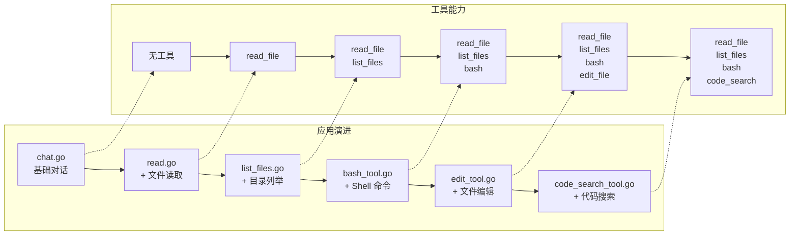
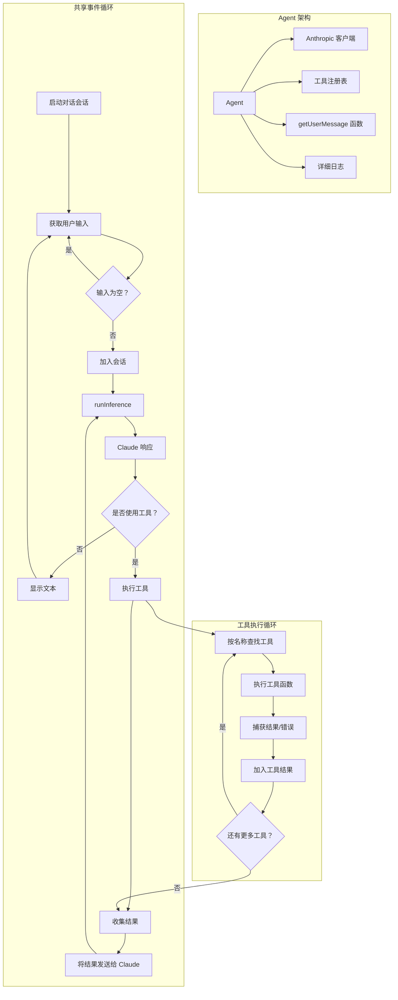

# 🧠 通过分步工作坊从零构建你自己的编程 Agent

[English](README.md) | **简体中文**

欢迎！👋 本工作坊将带你一步步构建属于自己的 **AI 编程助手**——从最基础的聊天机器人起步，逐步加入文件读取、Shell 命令执行、代码搜索等强大工具。

你不需要是 AI 专家，只要跟着步骤动手构建即可！

🌐 **想了解更详细的整体介绍？** 请阅读博客文章：[ghuntley.com/agent](https://ghuntley.com/agent/)

---

## 🎯 你将学到什么

完成本工作坊后，你将理解如何：

- ✅ 连接 Anthropic Claude API
- ✅ 构建一个简单的 AI 聊天机器人
- ✅ 添加读取文件、编辑代码、执行命令等工具
- ✅ 处理工具调用请求与错误
- ✅ 构建一个能力逐步增强的 Agent

---

## 🛠️ 我们将构建什么

你将构建 6 个版本的编程助手，每个版本都在前一版基础上增加功能：

1. **基础对话**——与 Claude 交谈
2. **文件读取器**——读取代码文件
3. **文件浏览器**——列出目录中的文件
4. **命令执行器**——运行 Shell 命令
5. **文件编辑器**——修改文件
6. **代码搜索**——用模式匹配搜索代码库



最终，你将拥有一个强大的本地开发者助手！

---

## 🧱 工作原理（架构）

每个 Agent 都按以下流程工作：

1. 等待你的输入
2. 将输入发送给 Claude
3. Claude 可能直接回复，也可能请求使用某个工具
4. Agent 执行该工具（例如读取文件）
5. 将工具结果发回 Claude
6. Claude 给出最终答复

我们称之为 **事件循环**——它就像是 Agent 的心跳。



## 🚀 快速开始

### ✅ 前置要求

* Go 1.24.2+ 或 [devenv](https://devenv.sh/)（推荐，可快速完成环境搭建）
* 一个 [Anthropic API Key](https://platform.claude.com/settings/keys)

### 🔧 配置开发环境

**方式一：推荐（使用 devenv）**

```bash
devenv shell  # 加载你所需的一切环境
```

**方式二：手动配置**

```bash
# 确认已安装 Go
go mod tidy
```

### 🔐 配置 API Key

```bash
export ANTHROPIC_API_KEY="your-api-key-here"
```

---

## 🏁 从基础开始

### 1. `chat.go`——基础对话

一个与 Claude 对话的简单聊天机器人。

```bash
go run chat.go
```

* ➡️ 试试说：“Hello!”
* ➡️ 加上 `--verbose` 查看详细日志

---

## 🛠️ 逐步添加工具（一次一个）

### 2. `read.go`——读取文件

现在 Claude 可以读取你电脑上的文件了。

```bash
go run read.go
```

* ➡️ 试试：“Read fizzbuzz.js”

---

### 3. `list_files.go`——浏览目录

让 Claude 查看你的目录内容。

```bash
go run list_files.go
```

* ➡️ 试试：“List all files in this folder”
* ➡️ 试试：“What's in fizzbuzz.js?”

---

### 4. `bash_tool.go`——运行 Shell 命令

允许 Claude 运行安全的终端命令。

```bash
go run bash_tool.go
```

* ➡️ 试试：“Run git status”
* ➡️ 试试：“List all .go files using bash”

---

### 5. `edit_tool.go`——编辑文件

Claude 现在可以**修改代码**、创建文件并做出改动了。

```bash
go run edit_tool.go
```

* ➡️ 试试：“Create a Python hello world script”
* ➡️ 试试：“Add a comment to the top of fizzbuzz.js”

---

### 6. `code_search_tool.go`——搜索代码

使用模式搜索（由 [ripgrep](https://github.com/BurntSushi/ripgrep) 驱动）。

```bash
go run code_search_tool.go
```

* ➡️ 试试：“Find all function definitions in Go files”
* ➡️ 试试：“Search for TODO comments”

---

## 🧪 示例文件（已包含）

1. `fizzbuzz.js`：用于文件读取与编辑
2. `riddle.txt`：一个有趣的文本文件，可供探索
3. `AGENT.md`：项目环境说明

---

## 🐞 故障排查

**API Key 不生效？**

* 确认已导出：`echo $ANTHROPIC_API_KEY`
* 在 [Anthropic 控制台](https://www.anthropic.com) 检查你的配额

**Go 报错？**

* 运行 `go mod tidy`
* 确认 Go 版本为 1.24.2 或更高

**工具报错？**

* 使用 `--verbose` 查看完整错误日志
* 检查文件路径与权限

**环境问题？**

* 使用 `devenv shell` 避免配置问题

---

## 💡 工具的工作原理（底层）

工具就像插件，你需要定义：

* **名称**（例如 `read_file`）
* **输入 Schema**（需要哪些信息）
* **函数**（具体做什么）

Go 中的工具定义示例：

```go
var ToolDefinition = ToolDefinition{
    Name:        "read_file",
    Description: "Reads the contents of a file",
    InputSchema: GenerateSchema[ReadFileInput](),
    Function:    ReadFile,
}
```

Schema 由 Go struct 生成——因此定义和复用都很方便。

---

## 🧭 工作坊路线：边做边学

| 阶段 | 学习重点                                 |
| ---- | ---------------------------------------- |
| **1** | `chat.go`：API 集成与响应处理            |
| **2** | `read.go`：工具系统、Schema 生成         |
| **3** | `list_files.go`：多工具、文件系统        |
| **4** | `bash_tool.go`：Shell 执行、错误捕获     |
| **5** | `edit_tool.go`：文件编辑、安全校验       |
| **6** | `code_search_tool.go`：模式搜索、ripgrep |

---

## 🛠️ 开发者环境（可选）

如果你使用 [`devenv`](https://devenv.sh/)，它会提供：

* Go、Node、Python、Rust、.NET
* Git 及其他开发工具

```bash
devenv shell   # 加载全部环境
devenv test    # 运行检查
hello          # 问候脚本
```

---


---

## 🧪 进阶路线：Eino Agent 模块

上面的工作坊示例刻意保持很小。如果你想看一个更完整、可运行的 agent，请阅读独立 Go module [`eino-agent/`](eino-agent/README.md)：

| 分支 | 运行时 | 学习重点 |
| --- | --- | --- |
| `feat/eino-code-agent` | Eino `flow/agent/react` | 最小完整 ReAct 循环、流式、工具错误 |
| `feat/eino-code-agent-adk` | Eino ADK `ChatModelAgent` + `Runner` | middleware、checkpoint、interrupt/resume |

它补齐了 demo 之外真正难的部分：

- 工作区边界、审批模式、stdin 单所有者；
- 读后写、`apply_patch`、文件 checkpoint 与 `/undo`；
- `repo_map` + `.einoignore`；
- 重试/退避和 session 级 token 预算；
- 敏感文件与环境变量策略；
- JSONL trace、确定性 fake provider、eval 场景；
- stdio MCP 工具、只读 `task` 子 agent，以及渐进式披露的 `SKILL.md` 技能。

```bash
cd eino-agent
go test ./...                       # 不需要 API key
go test ./internal/agent -run TestEvalScenarios -v
go build -o eino-agent ./cmd/eino-agent
./eino-agent --provider fake \
  --script testdata/scenarios/read_edit.json --workspace /tmp/eino-demo --no-stream
```

从 [`eino-agent/docs/README.md`](eino-agent/docs/README.md) 开始：它按“ReAct 循环 → 工具边界 → 上下文 → trace/eval → 失败画廊”组织。

## 🚀 下一步做什么？

完成工作坊后，可以尝试构建：

* 自定义工具（例如 API 调用器、网页抓取器）
* 工具链（按顺序运行多个工具）
* 记忆能力（跨会话记住信息）
* 为你的 Agent 构建 Web UI
* 集成其他 AI 模型

---

## 📦 总结

本工作坊帮助你：

* 理解 Agent 架构
* 学习构建智能助手
* 逐步扩展能力
* 练习将 Claude 与 Go 结合使用

---

祝你探索愉快，构建出属于自己的 AI 工具！💻✨

如果你有疑问或想法，欢迎 fork 仓库、提交 issue，或与社区交流！
